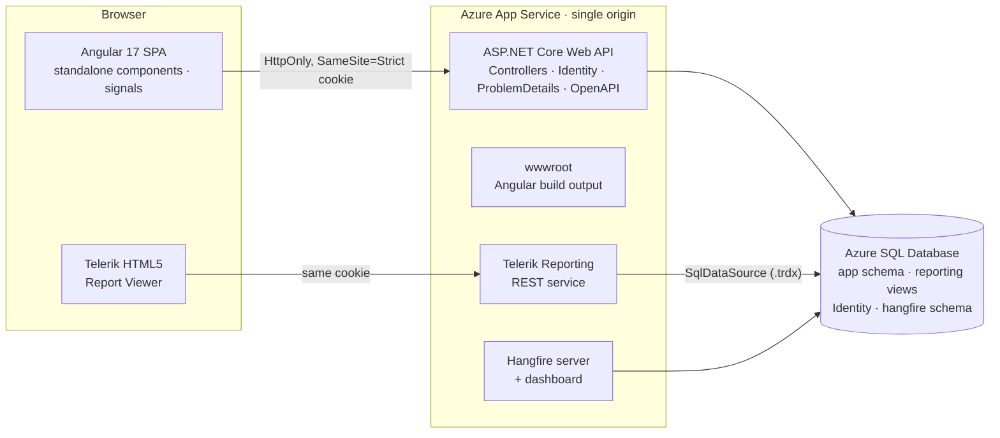
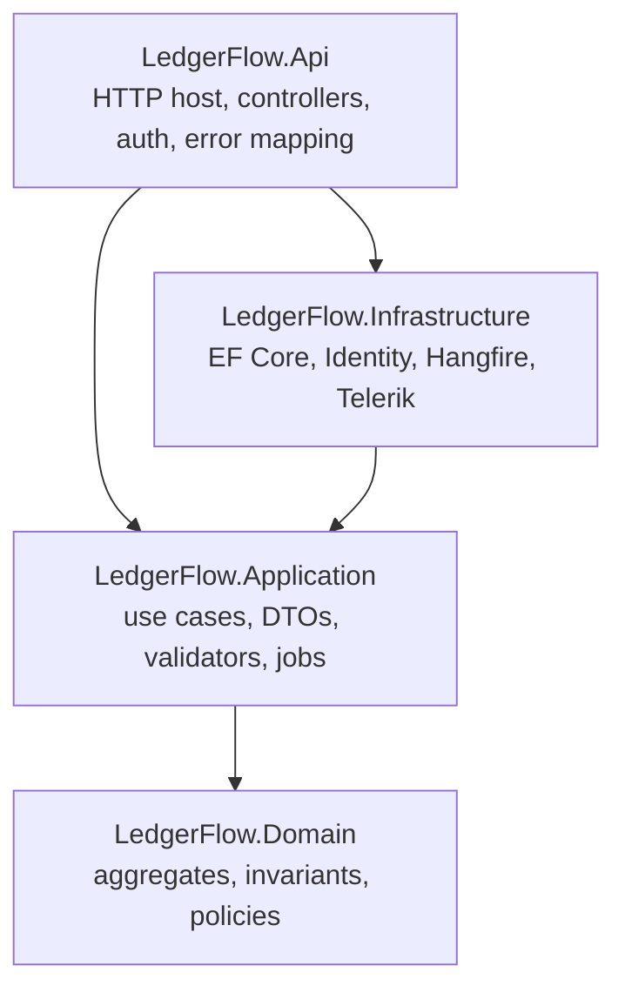
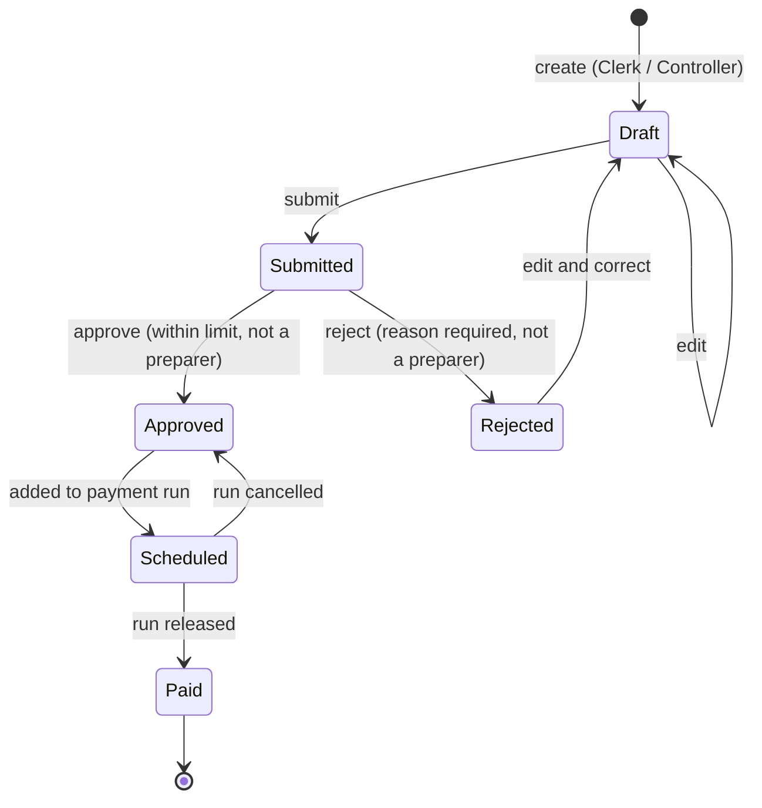
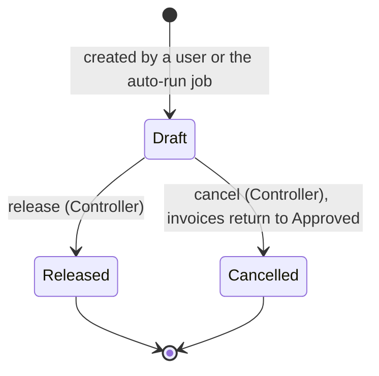

# LedgerFlow

**An accounts payable platform that puts financial controls in the domain model.** Clerks enter vendor invoices. Approvers sign off within a dollar limit. Controllers release payment runs that settle invoices with sequential ACH references. Recurring jobs flag overdue payables, snapshot AP aging, draft the next payment run and file reports. Every state change is written to an append-only audit trail.

**Stack:** C# / ASP.NET Core (.NET 9), EF Core, Azure SQL, Hangfire, Telerik Reporting, Angular 17, Bootstrap 5, Azure DevOps, Bicep

[Live demo](https://ledgerflow.vercel.app/) · [Demo accounts](docs/DEMO-ACCOUNTS.md) · API reference at `/scalar` when running locally

---

## Contents

1. [Highlights](#highlights)
2. [System architecture](#system-architecture)
3. [Domain model and invariants](#domain-model-and-invariants)
4. [Authorization model](#authorization-model)
5. [Persistence and data integrity](#persistence-and-data-integrity)
6. [Background processing](#background-processing)
7. [Reporting](#reporting)
8. [Frontend architecture](#frontend-architecture)
9. [Security](#security)
10. [API surface](#api-surface)
11. [Testing strategy](#testing-strategy)
12. [CI/CD and infrastructure](#cicd-and-infrastructure)
13. [Running locally](#running-locally)
14. [Repository layout](#repository-layout)
15. [Engineering conventions](#engineering-conventions)

---

## Highlights

| Area | What it does |
| --- | --- |
| **Financial controls** | Segregation of duties (no one approves an invoice they entered, edited or submitted), approval limits per role, mandatory rejection reasons, and payment release restricted to controllers. All of this is enforced inside the aggregate, so no endpoint can bypass it. |
| **Workflow integrity** | Explicit state machines for invoices and payment runs. Illegal transitions raise typed domain errors that map to `409` responses with a stable `code`. |
| **Concurrency** | SQL Server `rowversion` optimistic concurrency on vendors and invoices. Payment-run drafting runs inside a retriable transaction (execution strategy). Unique indexes are the final guard against duplicate invoices. |
| **Auditability** | Every invoice action writes an `InvoiceEvent` (who, what, when, why). An EF Core `SaveChangesInterceptor` stamps `CreatedBy/At` and `UpdatedBy/At` on every entity. |
| **Background work** | Five recurring Hangfire jobs plus fire-and-forget notifications, all persisted in SQL Server and safe to re-run. |
| **Reporting** | Three report definitions backed by SQL views: CSV export, Telerik PDF rendering, an in-browser viewer and a weekly archive. |
| **Delivery** | One-origin deployment (SPA, API, report service and job dashboard behind one cookie), Bicep infrastructure as code, and a two-stage Azure DevOps pipeline that deploys through an environment with a SQL Server service container and a smoke test. |
| **Quality gates** | Nullable reference types, .NET analyzers, warnings as errors, 34 unit tests, 20 HTTP-level integration tests against a real SQL Server, and 16 Angular tests. |

---

## System architecture



### Layering

The backend follows Clean Architecture. Dependencies point inward only.



| Project | Responsibility | Depends on |
| --- | --- | --- |
| `LedgerFlow.Domain` | Aggregates (`Invoice`, `PaymentRun`, `Vendor`), value types, `ApprovalPolicy`, `DomainException`. No framework references. | — |
| `LedgerFlow.Application` | One service per feature (`InvoiceService`, `PaymentRunService`, …), FluentValidation validators, read-model projections and Hangfire job bodies. Talks to persistence only through `ILedgerFlowDb`. | Domain |
| `LedgerFlow.Infrastructure` | `LedgerFlowDbContext`, entity configurations, migrations, the audit interceptor, ASP.NET Identity stores, the Hangfire scheduler adapter and the Telerik PDF renderer. | Application |
| `LedgerFlow.Api` | Composition root, attribute-routed controllers, cookie and bearer auth, rate limiting, RFC 9457 error mapping, OpenAPI and health checks. | Application, Infrastructure |

### Request lifecycle

1. The SPA calls `/api/...` with the auth cookie. The functional HTTP interceptor sends credentials and turns a `401` into a redirect to the login page.
2. ASP.NET Core authenticates the request, checks the endpoint's `[Authorize(Roles = ...)]` and binds the request DTO.
3. The application service validates the DTO with FluentValidation, loads the aggregate through `ILedgerFlowDb`, and calls a domain method (`invoice.Approve(...)`).
4. The aggregate enforces its invariants, mutates its state and appends an audit event.
5. `SaveChangesAsync` runs the audit interceptor and EF Core's `rowversion` check, then commits.
6. Side effects that don't need to block the response, such as decision notifications, are enqueued to Hangfire through `IJobScheduler`.
7. Any `DomainException`, `ValidationException`, `NotFoundException` or `DbUpdateConcurrencyException` is translated by `ApiExceptionHandler` into `application/problem+json` with a machine-readable `code`.

---

## Domain model and invariants

### Invoice lifecycle



### Payment run lifecycle



On release, each payment gets a deterministic remittance reference, `ACH-{yyyyMMdd}-{runId:D4}-{seq:D3}` (for example `ACH-20260925-0034-001`). Each invoice is marked paid in the same unit of work.

### Business rules

Each rule is enforced inside the aggregate method that changes the state, and each has a stable error code.

| Rule | Enforced in | Error code |
| --- | --- | --- |
| Whoever **entered, edited or submitted** an invoice cannot approve or reject it | `Invoice.EnsureSegregationOfDuties` | `segregation_of_duties` |
| Approvers can approve up to **$10,000**; above that requires a Controller | `Invoice.Approve` + `ApprovalPolicy` | `approval_limit_exceeded` |
| Only Approvers and Controllers can approve | `Invoice.Approve` | `approval_forbidden` |
| A rejection must carry a reason the clerk can act on | `Invoice.Reject` | `rejection_reason_required` |
| Only Draft or Rejected invoices can be edited | `Invoice.UpdateDraft` | `invoice_not_editable` |
| Submission needs at least one line and a positive total | `Invoice.Submit` | `invoice_empty` |
| Invoices can only be raised against active vendors | `Invoice` constructor | `vendor_inactive` |
| An invoice cannot move to another vendor | `InvoiceService.UpdateAsync` | `vendor_immutable` |
| Vendor + invoice number must be unique (duplicate payment guard) | Service check + unique index | `duplicate_invoice` |
| Only Approved invoices can be scheduled | `Invoice.Schedule` (internal to the aggregate) | `invoice_not_payable` |
| Only Controllers release or cancel runs; empty runs cannot be released | `PaymentRun.Release` / `PaymentRunService.CancelAsync` | `release_forbidden`, `cancel_forbidden`, `payment_run_empty` |
| Released and cancelled runs are immutable | `PaymentRun.EnsureDraft` | `payment_run_locked` |

Due dates come from the vendor's payment terms (`InvoiceDate + PaymentTermsDays`). Line totals and tax are rounded to cents with `MidpointRounding.AwayFromZero`. `Invoice.Schedule`, `Unschedule` and `MarkPaid` are `internal`, so only `PaymentRun` can move an invoice into or out of payment.

---

## Authorization model

Three roles, enforced twice: by `[Authorize(Roles = ...)]` at the endpoint, and by the domain rules above.

| Capability | Clerk | Approver | Controller |
| --- | :---: | :---: | :---: |
| View dashboard, invoices, vendors, reports | ✓ | ✓ | ✓ |
| Create and edit vendors | ✓ | | ✓ |
| Activate and deactivate vendors | | | ✓ |
| Enter, edit and submit invoices | ✓ | | ✓ |
| Approve or reject invoices ≤ $10,000 | | ✓ | ✓ |
| Approve or reject invoices > $10,000 | | | ✓ |
| Draft payment runs | ✓ | | ✓ |
| Release or cancel payment runs | | | ✓ |
| View and trigger background jobs, open the Hangfire dashboard | | | ✓ |

Segregation of duties applies on top of these roles. A Controller who edits a clerk's draft becomes a preparer of that invoice and can no longer decide on it. The approval queue excludes such invoices, and the API refuses the decision.

---

## Persistence and data integrity

**Schema.** EF Core code-first, with one `IEntityTypeConfiguration<T>` per entity and two migrations: `InitialCreate` and `ReportingViews`. Money columns are `decimal(18,2)` and dates use `DateOnly`.

| Concern | Implementation |
| --- | --- |
| Optimistic concurrency | `rowversion` on `Vendor` and `Invoice`. The client sends back the base64 token it loaded, and `ConcurrencyToken.Apply` sets it as the original value. Stale writes become `409 concurrency_conflict`. |
| Transactions | `PaymentRunService.DraftAsync` and `AgingSnapshotJob` run inside `CreateExecutionStrategy().ExecuteAsync(...)` with an explicit transaction, so transient Azure SQL faults are retried as a whole unit. |
| Uniqueness | Unique indexes on `(VendorId, InvoiceNumber)`, `Vendor.TaxId`, `(PaymentRunId, InvoiceId)` and `(SnapshotDate, Bucket)`. Violations (SQL 2601/2627) map to `409 duplicate`. |
| Query performance | Composite index `(Status, DueDate)` for the work queues, a filtered index on `IsOverdue = 1`, and `(InvoiceId, OccurredAt)` for the audit timeline. List endpoints project straight into DTOs with `AsNoTracking`. |
| Audit stamping | `AuditInterceptor` fills `CreatedBy/At` on insert and `UpdatedBy/At` on update from `ICurrentUser`. Background jobs run as named system actors (`system:overdue-job`, …). |
| Set-based writes | `ExecuteDeleteAsync` replaces the day's aging snapshot, and `ExecuteUpdateAsync` marks notifications read, with no change-tracker round trips. |
| Reporting views | `vw_ApAging`, `vw_VendorSpend` and `vw_PaymentRemittance` are created by migration and mapped as keyless entities. The same views feed CSV export and the Telerik `.trdx` definitions. |
| Time | All business logic takes `TimeProvider`, so tests can pin "now". |

---

## Background processing

Hangfire runs inside the web app with SQL Server storage in its own `hangfire` schema. Job schedules live in one catalog (`Application/Jobs/JobCatalog.cs`). Job bodies are plain application classes, so tests call them directly without a Hangfire server.

| Job | Schedule (UTC) | Purpose | Re-run safety |
| --- | --- | --- | --- |
| `overdue-invoices` | `0 6 * * *` | Flags unpaid invoices past due and alerts AP | `RefreshOverdue` changes state only when the flag flips, and writes one audit event per transition |
| `payment-reminders` | `15 6 * * *` | Reminds controllers about approved invoices due within 7 days | Skips if today's reminder already exists |
| `aging-snapshot` | `30 23 * * *` | Stores daily aging buckets for the 30-day trend chart | Deletes and re-inserts today's rows in one transaction |
| `auto-payment-run` | `0 7 * * 1` | Drafts a run from approved invoices due within 10 days, paying on the next business day | No-op while another draft is awaiting release |
| `weekly-aging-report` | `0 8 * * 1` | Renders the AP aging report and files it in the archive | Each run is a timestamped archive entry |
| Decision notification | fire-and-forget | Notifies the clerk when an invoice is approved or rejected (including the reason) | Enqueued after commit |

Controllers can view the last run, next run and state of every job, and trigger one on demand, from the **Background jobs** page or the Hangfire dashboard at `/hangfire`. Access to the dashboard is protected by a role-checked authorization filter.

---

## Reporting

| Report | Source | Parameters |
| --- | --- | --- |
| AP aging (current, 1–30, 31–60, 61–90, 90+) | `vw_ApAging` | — |
| Vendor spend by month and category | `vw_VendorSpend` | `from`, `to` |
| Payment remittance advice | `vw_PaymentRemittance` | `paymentRunId` |

Rendering sits behind `IReportRenderer`, and the build picks the implementation:

| Build | Output |
| --- | --- |
| `dotnet build` | CSV export for every report and CSV in the weekly archive |
| `dotnet build -p:UseTelerik=true` | Adds the Telerik REST service, the interactive Angular report viewer, PDF export and a PDF archive |

The Telerik code paths are compiled behind `#if TELERIK`, and package versions are pinned centrally in `Directory.Packages.props`. Telerik feed credentials come from `TELERIK_NUGET_USER` / `TELERIK_NUGET_KEY` and the license from `TELERIK_LICENSE`. The Angular viewer (`@progress/telerik-angular-report-viewer` 28.25.1111) is loaded with `@defer`, so it adds nothing to the initial bundle.

---

## Frontend architecture

Angular 17 with standalone components, signals and the built-in control flow (`@if`, `@for`, `@defer`). Each business area is lazy loaded.

| Folder | Contents |
| --- | --- |
| `core/api` | One typed service per resource (`InvoicesApi`, `PaymentRunsApi`, …) |
| `core/auth` | `AuthService` (signal-based session state), functional `authGuard` and `roleGuard`, and the HTTP interceptor |
| `core/http` | Problem-details parsing, so form errors and toasts show the server's validation messages |
| `core/models` | TypeScript contracts that mirror the API DTOs |
| `shared/ui` | `status-badge`, `pager`, `loading` |
| `layout/shell` | Role-aware sidebar, notification feed (polled every 30 s), user menu |
| `features/*` | `dashboard`, `invoices` (list, detail, form), `approvals`, `payment-runs` (list, new, detail), `vendors`, `reports`, `jobs`, `auth/login` |

- **State.** Component state lives in signals and computed values, and server calls are RxJS observables. Typed reactive forms back the invoice and vendor editors.
- **Change detection.** Every component is `OnPush`.
- **Charts.** The dashboard charts are hand-built SVG, with no charting dependency.
- **Imports.** Code is imported through the `@core`, `@shared`, `@features` and `@layout` path aliases. Relative `../../` imports are not used.
- **Theme.** A custom Bootstrap 5.3 SCSS theme with tabular numerals for financial tables. The layout is responsive, with a collapsible sidebar below the `lg` breakpoint.
- **Build output.** `ng build` writes directly into the API's `wwwroot`, and the API serves `index.html` as the fallback for client routes.

---

## Security

- **Session.** An ASP.NET Core Identity cookie (`HttpOnly`, `SameSite=Strict`, 8-hour sliding expiration). No tokens are kept in browser storage, and no CORS is needed because everything is served from one origin. Bearer tokens are still available for API clients.
- **Account creation.** Self-registration is disabled: `/api/auth/register` returns `404`.
- **Brute force.** The login endpoints are rate-limited to 10 requests per minute per IP, with `429` on rejection.
- **Unauthenticated API calls.** They return `401`/`403` instead of redirecting, so the SPA handles them cleanly.
- **Security headers.** `X-Content-Type-Options: nosniff`, `X-Frame-Options: DENY` and `Referrer-Policy: strict-origin-when-cross-origin`. Outside development, HSTS is on and HTTP redirects to HTTPS.
- **Secrets.** These come from user-secrets locally and pipeline variable groups in CI. Bicep receives the SQL password as a `@secure()` parameter, and the web app has a system-assigned managed identity.
- **Errors.** Error responses never leak stack traces. Unexpected exceptions are logged with a source-generated `LoggerMessage` and returned as a generic `500 server_error`.

---

## API surface

| Endpoint | Purpose |
| --- | --- |
| `POST /api/auth/login?useCookies=true` | Sign in (cookie for the SPA; omit `useCookies` for a bearer token) |
| `GET /api/auth/me`, `POST /api/auth/logout` | Current user and roles; sign out |
| `GET/POST/PUT /api/vendors` | Vendor master data, activate and deactivate |
| `GET/POST/PUT /api/invoices` | Invoice search (status, vendor, overdue, text, sort, paging) and entry |
| `POST /api/invoices/{id}/submit · approve · reject` | Workflow transitions |
| `GET /api/invoices/approval-queue` | Invoices the caller is allowed to decide on |
| `GET /api/payment-runs/eligible-invoices` | Approved, unscheduled invoices |
| `GET/POST /api/payment-runs`, `POST /api/payment-runs/{id}/release · cancel` | Payment runs |
| `GET /api/dashboard` | KPIs, aging buckets, aging trend, monthly spend, top balances |
| `GET /api/notifications`, `POST /api/notifications/{id}/read · read-all` | Role and user notification feed |
| `GET /api/jobs`, `POST /api/jobs/{id}/trigger` | Recurring jobs (Controller) |
| `GET /api/reports/{name}.{csv,pdf}`, `GET /api/reports/archive` | Report export and archive |
| `/api/telerik-reports/*` | Telerik REST service (Telerik builds) |
| `GET /health` | Liveness, including the SQL check |

Example error:

```json
{
  "status": 409,
  "title": "Business rule violated",
  "detail": "Invoices above $10,000 require a controller's approval.",
  "code": "approval_limit_exceeded"
}
```

---

## Testing strategy

```bash
dotnet test backend/LedgerFlow.sln     # 34 unit + 20 integration tests
cd frontend && npm run test:ci         # 16 Angular tests in headless Chrome
```

| Suite | Scope | Notes |
| --- | --- | --- |
| `LedgerFlow.UnitTests` (xUnit) | Domain invariants, state transitions, totals and rounding, due-date terms, overdue detection, payment-run release and cancel, validators | Pure in-memory and deterministic. A fixed clock is used throughout. |
| `LedgerFlow.IntegrationTests` (xUnit + `WebApplicationFactory`) | Full invoice-to-payment workflow over HTTP, approval limits, segregation of duties (including edits by a second user), validation, duplicate detection, concurrency conflicts, role checks, job idempotency, reports, health and security headers | Boots the real API against a throwaway SQL Server database (`LedgerFlow_Tests_<guid>`) that is migrated, seeded and dropped. Override the server with `LEDGERFLOW_TEST_SQL`. |
| Angular (Karma + Jasmine) | Auth service, interceptor, problem-details parsing, pager, status badge, date utilities | Runs headless in CI |

---

## CI/CD and infrastructure

**Pipeline** (`azure-pipelines.yml`):

```mermaid
flowchart LR
    A[Push / PR to main] --> B[Restore + build<br/>warnings as errors]
    B --> C[SQL Server service container]
    C --> D[dotnet test<br/>unit + integration + coverage]
    D --> E[Angular tests<br/>headless Chrome]
    E --> F[ng build into wwwroot<br/>dotnet publish + zip]
    F --> G{main?}
    G -- yes --> H[Deployment job<br/>ledgerflow-dev environment]
    H --> I[Bicep: Azure SQL + App Service]
    I --> J[Zip deploy]
    J --> K[Smoke test /health]
```



NuGet and npm caches, published test results and Cobertura coverage are built in.

**Infrastructure** (`infra/main.bicep`):
- Azure SQL logical server and a serverless General Purpose database (`GP_S_Gen5`) with auto-pause.
- A Windows App Service plan and web app with a system-assigned managed identity.
- App settings for the environment, migrate-on-startup and seeding.
- Parameterized per environment through `main.dev.bicepparam`.

One-time Azure DevOps setup:
- An Azure Resource Manager service connection named `ledgerflow-azure`.
- A variable group `ledgerflow-secrets` holding `SqlAdminPassword`, plus `TelerikNugetKey` and `TelerikLicenseKey` for Telerik builds.
- An environment `ledgerflow-dev`. Add an approval check to it to gate production-style deploys.

Manual deployment:

```bash
az group create -n rg-ledgerflow-dev -l eastus2
LEDGERFLOW_SQL_PASSWORD='<strong password>' \
  az deployment group create -g rg-ledgerflow-dev -f infra/main.bicep -p infra/main.dev.bicepparam
```

---

## Running locally

**Prerequisites:** .NET 9 SDK, Node 20 (`frontend/.nvmrc`) and Docker. On Apple Silicon, enable Rosetta in Docker Desktop for the SQL Server image.

```bash
# 1. SQL Server 2022
docker compose up -d sql

# 2. API: applies migrations, seeds demo data, starts Hangfire  →  http://localhost:5076
dotnet run --project backend/src/LedgerFlow.Api

# 3. Angular dev server with proxy to the API  →  http://localhost:4200
cd frontend && npm ci && npm start
```

Alternatively, run `npx ng build` in `frontend/` and use the API alone on `:5076`.

| URL | What |
| --- | --- |
| http://localhost:4200 | Application |
| http://localhost:5076/scalar | Interactive API reference (OpenAPI) |
| http://localhost:5076/hangfire | Job dashboard (sign in as the controller first) |

Sign in with one of the seeded accounts in [docs/DEMO-ACCOUNTS.md](docs/DEMO-ACCOUNTS.md): `clerk@`, `approver@` or `controller@ledgerflow.dev`. The seed data covers about a year of activity: 18 vendors, 120 invoices across every status, weekly released payment runs, and notifications.

To use a different database, run `dotnet user-secrets set ConnectionStrings:LedgerFlow "<connection string>" --project backend/src/LedgerFlow.Api`.

**Visual Studio 2022:** open `backend/LedgerFlow.sln`. `LedgerFlow.Api` is the startup project, and Test Explorer discovers both xUnit projects.

---

## Repository layout

```
ledgerflow/
├── backend/
│   ├── LedgerFlow.sln
│   ├── Directory.Build.props        shared compiler settings, analyzers, Telerik build switch
│   ├── Directory.Packages.props     central package management
│   ├── global.json                  pins the .NET 9 SDK
│   ├── src/
│   │   ├── LedgerFlow.Domain/          Common/ Invoices/ Payments/ Vendors/ Operations/
│   │   ├── LedgerFlow.Application/     Abstractions/ Invoices/ Payments/ Vendors/ Dashboard/
│   │   │                               Notifications/ Reporting/ Jobs/
│   │   ├── LedgerFlow.Infrastructure/  Persistence/ (Configurations, Interceptors, Migrations)
│   │   │                               Identity/ Jobs/ Reporting/
│   │   └── LedgerFlow.Api/             Controllers/ Hosting/ Reports/*.trdx Program.cs
│   └── tests/
│       ├── LedgerFlow.UnitTests/
│       └── LedgerFlow.IntegrationTests/
├── frontend/src/app/
│   ├── core/        api/ auth/ http/ models/ toast/
│   ├── shared/      ui/ utils/
│   ├── layout/      shell/
│   └── features/    auth/ dashboard/ invoices/ approvals/ payment-runs/ vendors/ reports/ jobs/
├── infra/           main.bicep, main.dev.bicepparam
├── docs/            DEMO-ACCOUNTS.md
├── docker-compose.yml
└── azure-pipelines.yml
```

---

## Engineering conventions

**Backend**
- One type per file, with file-scoped namespaces that match folders.
- Nullable reference types, .NET analyzers and `TreatWarningsAsErrors` are enabled. Unused `using` directives fail the build.
- Domain state changes only through aggregate methods. Setters are private, and collections are exposed read-only.
- Application services return DTOs, never entities. Reads are projected in SQL with `AsNoTracking`.
- Package versions are managed centrally in `Directory.Packages.props`.

**Frontend**
- Every component has its own folder with separate `.ts`, `.html` and `.scss` files, and is standalone with `OnPush`.
- Shared code is imported only through path aliases.
- Strict TypeScript. Unused locals and parameters fail the build.
