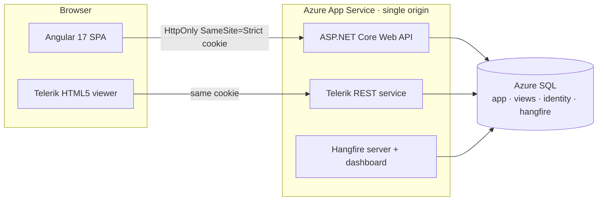
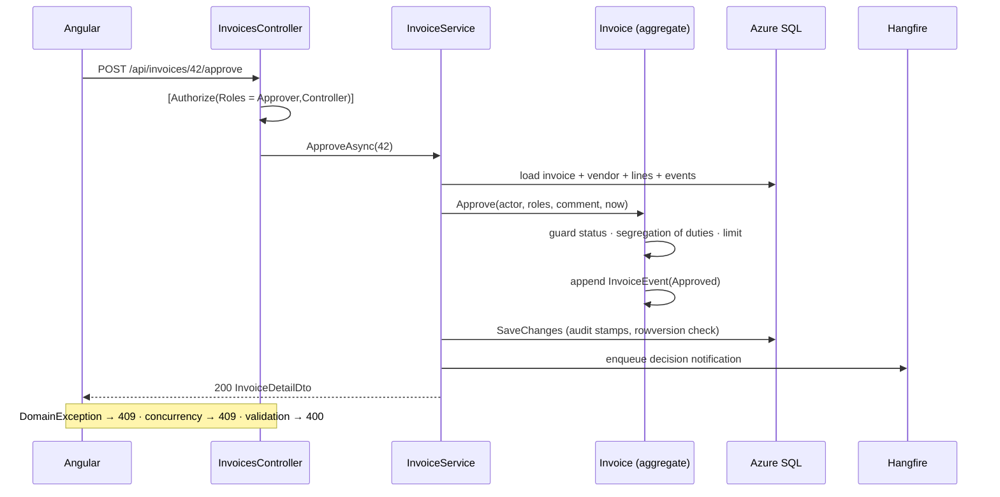
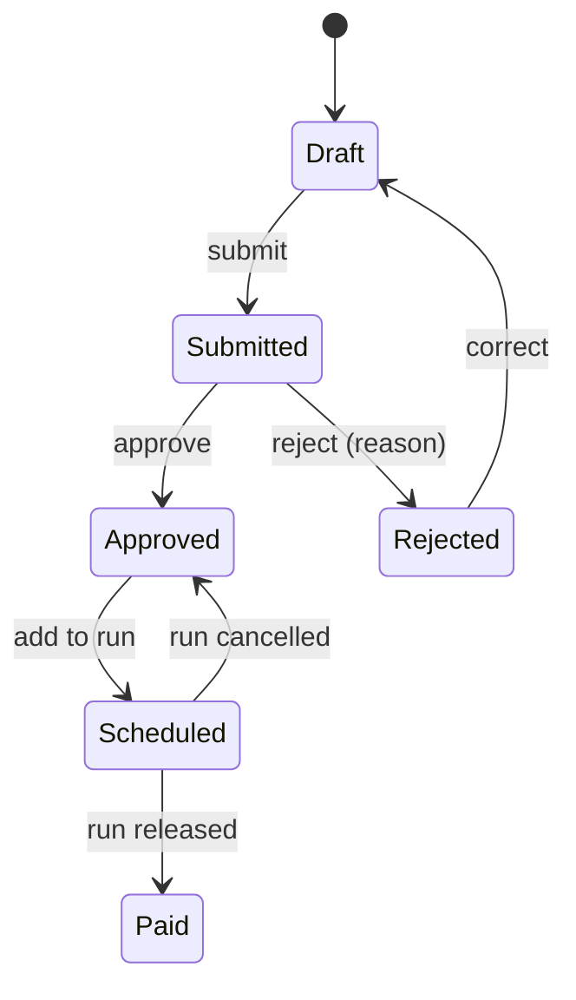

# LedgerFlow

LedgerFlow is a full-stack accounts payable system that automates the invoice-to-payment cycle and builds audit-grade internal controls into the domain layer. Every invoice is checked against segregation of duties, a $10,000 approver threshold and a duplicate-payment guard before money can move. Approved invoices are settled only through controller-released payment runs, which carry deterministic ACH remittance references. Five scheduled jobs flag overdue payables, snapshot AP aging, draft the weekly payment run and archive reports without manual effort. Every state transition is recorded in an append-only audit trail, which is the evidence internal audit asks for, and 70 automated tests verify the controls end to end.

**Stack:** C# · ASP.NET Core (.NET 9) · EF Core · Azure SQL · Hangfire · Telerik Reporting · Angular 17 · Bootstrap 5 · Azure DevOps · Bicep

[Live demo](https://ledgerflow.vercel.app/) · [Demo accounts](docs/DEMO-ACCOUNTS.md)

## At a glance

| Metric | Value |
| --- | --- |
| Enforced financial controls | Segregation of duties, approval limit, mandatory rejection reason, duplicate-invoice block, controller-only release |
| Typed domain error codes | 22, each returned as RFC 9457 problem details with a stable `code` |
| Invoice states / payment-run states | 6 / 3, as explicit state machines with guarded transitions |
| Recurring background jobs | 5, persisted in SQL Server and safe to re-run |
| HTTP endpoints | 33 controller actions + ASP.NET Identity auth endpoints |
| Database indexes | 10 (4 unique, 1 filtered), plus 3 reporting views |
| Automated tests | 70: 34 unit, 20 HTTP integration against SQL Server, 16 Angular |
| Build gates | Nullable reference types, .NET analyzers, warnings as errors, strict TypeScript templates |

## Architecture



The SPA build is served from the API's `wwwroot`. The SPA, report service and job dashboard therefore share one origin and one auth cookie: there's no CORS and no token in browser storage.

The backend follows Clean Architecture, and dependencies point inward only:

| Project | Responsibility |
| --- | --- |
| `LedgerFlow.Domain` | Aggregates (`Invoice`, `PaymentRun`, `Vendor`), invariants, `ApprovalPolicy`. No framework references. |
| `LedgerFlow.Application` | Feature services, FluentValidation validators, SQL-projected read models and Hangfire job bodies. Persistence is reached only through `ILedgerFlowDb`. |
| `LedgerFlow.Infrastructure` | `DbContext`, entity configurations, migrations, the audit interceptor, Identity stores, the Hangfire adapter and the Telerik renderer. |
| `LedgerFlow.Api` | Composition root, controllers, auth, rate limiting, exception-to-problem-details mapping, OpenAPI and health checks. |

### Approval request path



## Domain model



Workflow rules live inside the aggregate, so no controller, job or service can skip them. Cross-record checks such as duplicates and vendor deactivation sit in the application service, with database constraints behind them.

```csharp
public void Approve(string actor, IReadOnlyCollection<string> actorRoles, string? comment, DateTimeOffset now)
{
    EnsureStatus("invoice_not_pending", "Only submitted invoices can be approved.", InvoiceStatus.Submitted);
    EnsureSegregationOfDuties(actor);   // entered, edited or submitted it → refused

    var isController = actorRoles.Contains(Roles.Controller);
    if (!isController && Total > ApprovalPolicy.ApproverLimit)
        throw new DomainException("approval_limit_exceeded", "...");

    Status = InvoiceStatus.Approved;
    Record(InvoiceEventType.Approved, actor, comment, now);
}
```

| Control | Error code |
| --- | --- |
| Whoever entered, edited or submitted an invoice cannot decide on it | `segregation_of_duties` |
| Approvers can approve up to $10,000; above that requires a Controller | `approval_limit_exceeded` |
| A rejection must include a reason | `rejection_reason_required` |
| Vendor + invoice number is unique (duplicate-payment guard) | `duplicate_invoice` |
| Only approved invoices can be scheduled for payment | `invoice_not_payable` |
| Only Controllers release or cancel runs; empty runs cannot be released | `release_forbidden`, `cancel_forbidden`, `payment_run_empty` |
| Released and cancelled runs are immutable | `payment_run_locked` |
| Invoices only against active vendors, and vendors with open invoices cannot be deactivated | `vendor_inactive`, `vendor_has_open_invoices` |

- **Encapsulation.** `Schedule`, `Unschedule` and `MarkPaid` are `internal`, so only `PaymentRun` can move an invoice into payment.
- **Settlement.** Release assigns `ACH-{yyyyMMdd}-{runId:D4}-{seq:D3}` and marks every invoice paid in a single unit of work.
- **Terms.** Due dates derive from vendor payment terms.
- **Money.** Amounts are `decimal(18,2)`, rounded `AwayFromZero`.
- **Time.** All logic takes `TimeProvider`, so tests can pin the clock.

### Role matrix

| Capability | Clerk | Approver | Controller |
| --- | :---: | :---: | :---: |
| Enter, edit and submit invoices; draft payment runs; maintain vendors | ✓ | | ✓ |
| Approve or reject invoices ≤ $10,000 | | ✓ | ✓ |
| Approve or reject invoices > $10,000; release or cancel runs; deactivate vendors; run jobs | | | ✓ |

Roles are enforced twice: by `[Authorize]` at the endpoint and by the aggregate. The approval queue is filtered in SQL so users never see invoices they prepared.

## Consistency and concurrency

| Concern | Implementation |
| --- | --- |
| Lost updates | `rowversion` on `Vendor` and `Invoice`. The client returns the base64 token it read. `ConcurrencyToken.Apply` compares it up front (which catches no-op edits) and sets it as the EF original value, so the `UPDATE ... WHERE RowVersion = @p` fails if another write lands in between. Either way the caller gets `409 concurrency_conflict`. |
| Parallel approvals and releases | Each decision updates the invoice row under its `rowversion`, so two concurrent approvals or releases cannot both commit. |
| Transient faults | `EnableRetryOnFailure(5)`. Multi-statement work (payment-run drafting, aging snapshots) runs inside `CreateExecutionStrategy().ExecuteAsync` with an explicit transaction, so the whole unit is retried. |
| Duplicates | Unique indexes on `(VendorId, InvoiceNumber)`, `Vendor.TaxId`, `(PaymentRunId, InvoiceId)` and `(SnapshotDate, Bucket)` back up the service checks. SQL errors 2601/2627 map to `409 duplicate`. |
| Auditing | `InvoiceEvent` rows record every transition (type, actor, comment, timestamp). A `SaveChangesInterceptor` stamps `CreatedBy/At` and `UpdatedBy/At` on every entity. Jobs act as named system principals. |
| Read performance | Indexes on `(Status, DueDate)` for work queues, a filtered index on `IsOverdue = 1`, and `(InvoiceId, OccurredAt)` for timelines. Lists project to DTOs in SQL with `AsNoTracking`. Reports read from `vw_ApAging`, `vw_VendorSpend` and `vw_PaymentRemittance`. |

## Background jobs

Hangfire uses SQL Server storage (`hangfire` schema, 5 s queue poll, `min(2 × CPU, 8)` workers). Schedules are declared in `JobCatalog`. Job bodies are plain application classes, so they are tested without a Hangfire server.

| Job | Cron (UTC) | Effect | Idempotency |
| --- | --- | --- | --- |
| `overdue-invoices` | `0 6 * * *` | Flags past-due open invoices and notifies AP | State changes only when the flag flips |
| `payment-reminders` | `15 6 * * *` | Alerts controllers to approved invoices due within 7 days | One reminder per day |
| `aging-snapshot` | `30 23 * * *` | Persists daily aging buckets for the 30-day trend | `ExecuteDelete` + insert in one transaction |
| `auto-payment-run` | `0 7 * * 1` | Drafts a run from invoices due within 10 days | Skipped while a draft awaits release |
| `weekly-aging-report` | `0 8 * * 1` | Renders AP aging and files it in the archive | Timestamped archive entry |

Approval and rejection decisions enqueue a fire-and-forget job that notifies the clerk, including the rejection reason.

## Reporting

Three reports are defined: AP aging, vendor spend and payment remittance. Each is defined once over a SQL view and rendered through `IReportRenderer`:

- **Default build:** CSV export and archive.
- **`-p:UseTelerik=true`:** adds the Telerik REST service, PDF export and an in-app viewer. The viewer is lazy-loaded with `@defer`, so it adds nothing to the initial bundle.

## Security

- **Session.** Identity cookie: `HttpOnly`, `SameSite=Strict`, 8-hour sliding expiry. Bearer tokens are available for API clients.
- **Credentials.** Passwords must be at least 10 characters. Accounts lock after 5 failed attempts, and the login endpoint is rate-limited to 10 requests per minute per IP (`429`).
- **Account creation.** Self-registration is disabled.
- **API responses.** Unauthenticated calls return `401`/`403` instead of redirecting. Errors never expose stack traces.
- **Headers.** `nosniff`, `X-Frame-Options: DENY` and a strict referrer policy. HSTS and HTTPS redirection are on outside development.
- **Hangfire dashboard.** Restricted to authenticated Controllers.
- **Secrets.** User-secrets locally, pipeline variable groups in CI, a `@secure()` Bicep parameter, and a system-assigned managed identity on the web app.

## Frontend

- **Framework.** Angular 17 standalone components with signals, built-in control flow and `OnPush` throughout. Every feature route is lazy loaded.
- **Code structure.** `core/` holds typed API clients, auth state, guards, the interceptor and problem-details parsing. `shared/` holds reusable UI. `features/` has one folder per business area.
- **Imports.** Only through the `@core`, `@shared`, `@features` and `@layout` aliases.
- **UI.** Dashboard charts are dependency-free SVG, and the custom Bootstrap 5.3 theme uses tabular numerals for financial tables.
- **Server errors.** Validation and domain errors from the API appear inline on forms and in toasts.

## Testing

```bash
dotnet test backend/LedgerFlow.sln     # 34 unit + 20 integration
cd frontend && npm run test:ci         # 16 Angular
```

- **Unit (xUnit).** State transitions, every control above, totals and rounding, payment terms, overdue detection, run release and cancel, and validators.
- **Integration (`WebApplicationFactory`).** Boots the real API over HTTP against a throwaway SQL Server database that is migrated, seeded and dropped. It covers the full invoice-to-payment flow, approval limits, segregation of duties (including edits by a second user), concurrency conflicts, duplicate detection, role checks, job idempotency, reports and security headers.
- **Angular (Karma/Jasmine).** Auth service, interceptor, error parsing and shared components.

## CI/CD and infrastructure

`azure-pipelines.yml` has two stages:
1. **Build and test** runs on every push and PR. It builds with warnings as errors and runs unit and integration tests against a SQL Server service container (results and Cobertura coverage are published). It then runs the Angular tests, builds the SPA into `wwwroot`, and publishes and zips the deployment package.
2. **Deploy** runs on `main` through the `ledgerflow-dev` environment. It provisions infrastructure with `infra/main.bicep` (Azure SQL serverless `GP_S_Gen5` with auto-pause, and a Windows App Service with managed identity), zip-deploys, and polls `/health`.

## Running locally

Requires the .NET 9 SDK, Node 20 and Docker.

```bash
docker compose up -d sql                              # SQL Server 2022
dotnet run --project backend/src/LedgerFlow.Api       # migrates, seeds, starts Hangfire → :5076
cd frontend && npm ci && npm start                    # → :4200
```

The seed data covers about a year of activity: 18 vendors, 120 invoices across every state, and weekly payment runs. Sign in with an account from [docs/DEMO-ACCOUNTS.md](docs/DEMO-ACCOUNTS.md). The API reference is at `:5076/scalar` and the job dashboard at `:5076/hangfire`.
